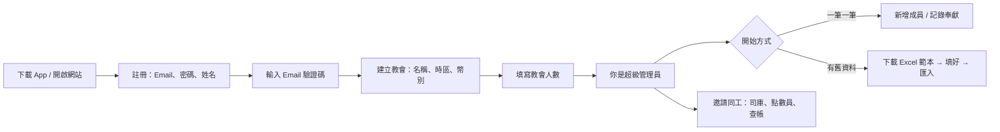

# Church Finance App（多教會版）設計

日期：2026-10-27　狀態：已確認（2026-10-27），App 名稱待定

## 目標

把現有的 BOLCCOP 財務系統（`Finance/`）做成任何教會都能註冊使用的 App，上架 App Store：

1. 第一次使用：註冊個人帳戶 → 設定教會名稱 → 成為該教會的**超級管理員** → 開始記錄奉獻。
2. 可用 Excel 匯入以往的成員與奉獻，提供 Excel 範本下載。
3. 教會人數 100 人以內免費；超過 100 人每月 **5.99 美元**。教會人數由建立教會的人手動填寫。
4. 「支持開發者」：使用者可自願奉獻，鼓勵作者繼續開發。
5. **和現在教會共用一套程式碼**：BOLCCOP 繼續照常使用，新功能兩邊同時受益。

不在這一版範圍：線上收奉獻（會友用 App 付款給教會）、Android（架構上預留，第二階段再做）。

---

## 核心決定

### 1. 同一套程式碼，兩種部署模式

```
Finance/ 同一份程式碼
├── 部署 A：finance.bolccop.org   MODE=single  — BOLCCOP 現況，資料仍在原本的 D1，零遷移
└── 部署 B：app.<品牌>.com        MODE=saas    — 多教會、註冊、訂閱、App Store
```

- `single` 模式行為和今天完全一樣：沒有註冊頁、沒有付費限制、原本的 D1 與 VPS 備援照舊。
- `saas` 模式多出「平台層」（帳戶、教會、訂閱），每間教會的帳務資料各自獨立。
- 兩種模式共用 99% 的程式：成員、奉獻、支出、報表、稅單、對帳、匯入匯出全是同一份。
- 日後 BOLCCOP 想搬進 saas 也只是把資料匯出再匯入一間教會，不必先做。

為什麼不直接把 BOLCCOP 改成多教會：現有資料、權限（dev/counter 角色、測試資料旗標）、郵件審批、VPS 備援都在線上運作，硬改風險高、收益低。

### 2. 每間教會一個獨立資料庫（Durable Object + SQLite）

| 方案 | 隔離 | 對現有程式的改動 | 評估 |
|---|---|---|---|
| 共用一個 D1，每張表加 `church_id` | 弱：任何一條查詢漏了 `WHERE church_id` 就看到別間教會的帳 | 改全部約 60 條 SQL | 不採用：財務資料外洩是最壞情況 |
| 每間教會一個 D1 | 強 | 小 | 不可行：D1 無法在 Worker 裡動態建立與綁定 |
| **每間教會一個 Durable Object，內建 SQLite** | **強：資料庫本身就是分開的** | **小：沿用 `vpsDb.ts` 的做法** | **採用** |

做法：

- 現有程式已經有一個「長得和 D1 一樣」的資料庫轉接層（`src/server/vpsDb.ts`，`DB_BACKEND=vps` 時使用）。照同樣介面寫 `doSqliteDb.ts`，把 `prepare().bind().all()/first()/run()` 和 `batch()` 接到 Durable Object 的 `ctx.storage.sql`。
- 整個 API 請求轉進該教會的 Durable Object，在裡面執行**原本的** API 處理函式（從 `index.ts` 抽成 `handleChurchApi(request, env)`），`env.DB` 換成這間教會的 SQLite。
  - 一次 API 呼叫 = 一次 Durable Object 請求，查詢在本機執行，比遠端 D1 更快。
- 資料表結構沿用 `migrations/` 的 SQL；Durable Object 第一次開啟或升版時自動套用尚未執行的 migration（記錄在自己的 `_migrations` 表）。
- 檔案（收據、頭像）照樣存 R2，key 前面加 `churches/<churchId>/`。
- Cloudflare 對 SQLite Durable Object 提供 30 天內任意時間點還原，備份照樣可匯出 JSON / Excel。

### 3. 平台層：一個小的共用 D1（`finance-platform`）

只放「誰是誰、屬於哪間教會、付了沒有」，**不放任何奉獻資料**：

| 表 | 欄位（摘要） |
|---|---|
| `accounts` | id, email（唯一）, password_hash, name, email_verified_at, created_at, deleted_at |
| `churches` | id, name, declared_size（教會人數，手填）, timezone, currency, locale, created_by, created_at, deleted_at |
| `church_users` | church_id, account_id, role（super_admin / finance_admin / counter / auditor）, status |
| `invitations` | token, church_id, email, role, expires_at |
| `entitlements` | church_id, source（apple / stripe）, product, status, expires_at, original_transaction_id |
| `support_gifts` | id, account_id, church_id, amount, currency, source, created_at（支持開發者的紀錄） |

- 一個帳戶可以屬於多間教會（例如同時替兩間教會管帳），登入後切換。
- 教會資料庫裡現有的 `users` 表保留，作為「這間教會的同工名單」鏡像（id = 平台帳戶 id），所以稽核紀錄、建立者等既有查詢完全不用改。

### 4. 登入

- Email + 密碼，註冊時寄 6 位數驗證碼。只用 Email 登入時，Apple 不要求加「Sign in with Apple」。日後若加 Google 登入，必須同時提供 Apple 登入。
- 網頁沿用 Cookie session；iOS App 內的 WebView 不可靠地保存跨站 Cookie，改用 `Authorization: Bearer` token，存在系統 Keychain（可配合 Face ID 解鎖）。伺服器兩種都接受。
- **App 內必須能刪除帳戶**（Apple 5.1.1(v)）：刪帳戶；若是某教會唯一的超級管理員，需先轉移或連同教會資料一併刪除（先提示匯出）。

---

## 使用流程

### 第一次使用



- 建立教會時自動建好常用奉獻類別（十一、感恩、建堂、宣教…）與付款方式（現金、支票、Zelle…），之後可改。
- 稅單、Email 寄件人、教會英文名、地址、EIN 等原本寫死成 BOLCCOP 的內容（`CHURCH_INFO`、`mailFrom`、`finance.bolccop.org`）全部改成每間教會的設定。`single` 模式下預設值就是今天的 BOLCCOP 資料，行為不變。

### Excel 範本與匯入

範本是一個 `.xlsx`，三個工作表，第一列是中英對照標題，類別與付款方式欄位有下拉選單（依該教會目前的設定產生）：

| 工作表 | 欄位 |
|---|---|
| 成員 Members | 姓名*、英文姓名、Email、電話、地址、城市、州、郵遞區號、分組、狀態（在籍/非在籍/訪客） |
| 奉獻 Offerings | 日期*、成員姓名*（或 Email）、金額*、類別*、付款方式*、支票號碼、備註 |
| 說明 Instructions | 每欄的格式與範例；不會被匯入 |

匯入分三步，確認前不寫入任何資料：

1. **上傳**：接受 `.xlsx` 與 `.csv`。也接受直接拿範本以外的表，只要能對上欄位名稱（中英文都認）。
2. **預覽**：逐列檢查並標示
   - 錯誤（不能匯入）：日期或金額讀不懂、缺必填欄位。
   - 對應：奉獻上的成員先用 Email 對，再用姓名對；對不到的列出來，讓使用者選「新增為成員」或「對應到某位既有成員」。
   - 新類別、新付款方式：列出來確認後自動建立。
   - 重複：同一位成員、同一天、同金額、同類別已存在的，預設略過。
   - 人數：匯入後若超過 100 人且未訂閱，這一步就提示（見下節）。
3. **確認匯入**：整批寫入並記一個匯入批次編號；批次可以**整批復原**（匯錯了不必一筆一筆刪）。

技術：用 ExcelJS（MIT 授權）產生範本與讀檔，只在打開匯入畫面時才載入，不拖慢 App 啟動。解析在瀏覽器裡做，伺服器只收整理好的 JSON，再驗證一次。

---

## 收費

### 規則

- 「教會人數」由建立教會的超級管理員**手動填寫**（建立教會時必填，之後可在設定裡修改），以此為準，不從成員名單計算。
- 100 人（含）以內：所有功能免費，沒有時間限制。
- 超過 100 人：需要「教會專業版」訂閱，每月 5.99 美元。
- 填寫超過 100 人而尚未訂閱（或訂閱過期）時：**可以查看與匯出全部資料，但不能新增或修改**（成員、奉獻、支出、匯入），畫面上方提示訂閱。不會因為沒續訂就讓人拿不回自己的帳。
- 把人數從 100 以上改成 100 以下，下次續訂日起回到免費（已付的期間照常有效）。
- 訂閱屬於**教會**，不屬於個人：任何一位超級管理員付款，全教會的同工都受益。

### 付款管道

Apple 規定：在 iOS App 裡購買數位服務（含這種訂閱）**必須用 App 內購買**（3.1.1）。所以：

| 在哪裡買 | 用什麼 | 備註 |
|---|---|---|
| iPhone / iPad App | Apple App 內購買（自動續訂訂閱，5.99 價格級距） | Apple 抽成：小型開發者計畫 15% |
| 網頁版 | Stripe Checkout 訂閱 | 手續費約 2.9% + 0.30；BOLCCOP 官網已在用 Stripe |

- 建議用 **RevenueCat** 統一管理兩邊的訂閱狀態：App 端接 StoreKit，網頁端接 Stripe，續訂、退款、過期都由它用 webhook 通知我們的 Worker，寫進 `entitlements`。每月營收 2,500 美元以內免費。
  - 不用 RevenueCat 也可以自己接 App Store Server API 與 Server Notifications v2，但要自己處理收據驗證、寬限期、退款，工作量多出一週以上。
- 在任一邊付款，兩邊都認得：教會在網頁上訂閱，iPhone 上也是專業版。

### 支持開發者（自願奉獻）

- **網頁版**：可自行輸入任意金額，用 Stripe 一次性付款。
- **iOS App 內**：Apple 規定給開發者的打賞也必須用 App 內購買，而 App 內購買只能是**事先設定好的固定金額**，無法讓使用者自行輸入。只提供一個 **4.99 美元**的品項（消耗型，可重複購買），並在畫面上說明「想奉獻其他金額可到網頁版」。
  - 美國商店區自 2025 年起允許 App 內放外部付款連結，但規則仍在變動、審核風險較高，第一版不建議這樣做。
- 用語避免寫成「捐款可抵稅」：開發者不是登記的非營利組織，Apple 也只允許經審核的非營利組織在 App 內收免抵稅以外的捐款（3.2.1(vi)）。介面文字建議用「支持開發」、「請作者喝杯咖啡」。

---

## App Store 上架

- **外殼**：用 Capacitor 把同一份 React 前端包成 iOS App，畫面與網頁版同一份程式。
- **避免被當成「只是包了網頁」退件**（4.2 最低功能要求）：
  - Face ID / Touch ID 快速登入；
  - 相機拍收據、拍支票，直接附到奉獻或支出；
  - 離線時可先記錄奉獻，連上網再自動上傳；
  - 原生分享：把稅單 PDF 直接用 AirDrop、郵件送出。
- **審核需要準備**：隱私權政策與使用條款網頁、App 隱私標籤（會收集姓名、Email、財務資料，不追蹤、不賣資料）、給審核員的示範帳號（一間有範例資料的教會）、App 內刪除帳戶。
- **需要你準備的帳號**：Apple Developer Program（每年 99 美元）、App 名稱與品牌網域、RevenueCat 帳號、Stripe 帳號（可與教會分開）。

---

## 雲端與成本

- **建議 saas 部署放在一個新的 Cloudflare 帳戶**，和教會帳戶分開：
  - 教會帳戶目前是免費方案，Durable Objects 每天 10 萬次的額度上週剛被會議室用到上限；商業產品必須用付費方案（每月 5 美元起），兩者混在一起會互相影響。
  - 收入、帳單、資料都和教會分開，比較乾淨。
- 預估成本：Workers 付費方案 5 美元/月起，含 1,000 萬次請求、Durable Objects 100 萬次請求與 5 GB SQLite 儲存，前幾百間教會都在這個額度內。

---

## 程式改動地圖

| 位置 | 改動 |
|---|---|
| `src/server/index.ts` | 把 `/api/*` 的教會業務部分抽成 `handleChurchApi(request, env, ctx)`；`fetch` 依 `MODE` 決定由誰提供 `env.DB` |
| `src/server/doSqliteDb.ts`（新） | D1 相容轉接層，接 `ctx.storage.sql`（仿 `vpsDb.ts`） |
| `src/server/churchStore.ts`（新） | Durable Object 類別：套 migration、執行 `handleChurchApi` |
| `src/server/platform/`（新） | 註冊、登入、Email 驗證、教會建立、邀請、切換教會、刪除帳戶、訂閱 webhook、人數上限 |
| `migrations-platform/`（新） | 平台 D1 的資料表 |
| `src/shared/taxStatement.ts` | `CHURCH_INFO` 改從教會設定讀；`single` 模式預設仍是 BOLCCOP |
| `src/App.tsx` | 註冊 / 建立教會 / 匯入精靈 / 方案與支持開發者頁；`single` 模式下這些入口不顯示 |
| `ios/`（新） | Capacitor 專案、App 內購買、Face ID、相機 |
| `wrangler.toml` / `wrangler.saas.toml` | 兩種部署各一份設定 |

順帶：`src/App.tsx` 已有 5,800 多行，新畫面放進 `src/pages/` 的獨立檔案，不再加長它。

---

## 分階段

第一版**全部功能上線**：成員、奉獻、支出（含審批、Email 審批連結、報銷申請）、對帳、稅單（含 Email 寄送）、報表、稽核紀錄、備份、匯入匯出。

| 階段 | 內容 | 完成時可以 | 估計 |
|---|---|---|---|
| 1 多教會核心 | 平台 D1、註冊登入、建立教會、每教會 Durable Object、教會設定取代寫死的 BOLCCOP 資料（稅單、寄件人、網址、報銷申請頁）；BOLCCOP 部署行為不變 | 在網頁上註冊一間新教會並使用全部功能 | 3–4 週 |
| 2 Excel | 範本下載、匯入精靈（預覽、對應、復原） | 帶舊資料上手 | 1 週 |
| 3 收費 | 人數計算與上限、Stripe 訂閱、網頁版支持開發者 | 網頁版開始收費 | 1 週 |
| 4 iOS | Capacitor、Bearer token、App 內購買（RevenueCat）、Face ID、相機、離線記錄、刪除帳戶、隱私政策、送審 | 上架 App Store | 2–3 週（含審核往返） |
| 5（之後） | Android、BOLCCOP 視需要搬進 saas | | |

每一階段都先讓 BOLCCOP 的測試全部通過再上線，確保共用程式不影響現有教會。

---

## 已確認（2026-10-27）

1. 價格以**美元**計：專業版每月 5.99 美元。
2. **教會人數由建立教會的人手動填寫**，不從成員名單計算。
3. App 名稱與網域：**待定**，第一階段用暫定名稱，不影響開發。
4. iOS 支持開發者只提供 **4.99 美元**一個品項；網頁版可自行輸入金額。
5. 多教會版使用 **Cloudflare 付費方案**，另開帳戶。
6. **不精簡**：第一版全部功能上線。
